
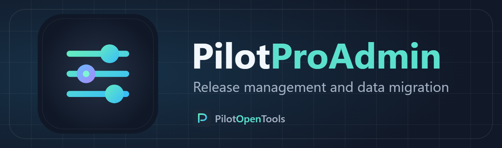

# PilotProAdmin

Веб-админка для Pilot-ICE и Pilot-BIM. Через неё автоматизации, отчёты, клиентские и серверные модули, типы и настройки серверов проходят путь от ветки в GitLab через проверки CI до серверов Pilot: тест, стейдж, прод. Рядом работает сервис PilotMigration: он переносит базы и файловые архивы между контурами.

[Документация](https://pilotopentools.github.io/PilotProAdmin/) · [Скачать релиз](https://github.com/PilotOpenTools/PilotProAdmin/releases/latest) · [Установка и устройство пакета](docs/installation-package.md)

## Главная идея: ветка = сервер

| Содержимое | Тест | Стейдж | Прод |
|---|---|---|---|
| Автоматизации | `dev` | `release/X.Y.Z` или вместе с тестом | `main` |
| Отчёты | `dev` | нет (или вместо теста, по настройке) | `main` |
| Клиентские и серверные модули | `dev` | `release/X.Y.Z` | `main` |
| Типы | `dev` | `release` | `main` |

- На сервер Pilot ничего не пишется в обход Git: сначала коммит и Merge Request, потом зелёный pipeline, и только после него запись на сервер. Если merge не удался, сервер откатывается.
- Версии и `CHANGELOG.md` ведутся автоматически, релизы помечаются тегами. Любую версию можно сравнить с другой и откатить.
- Прод — особый контур: опасные действия подтверждаются и доступны только по правам в GitLab. Права ниже Developer дают режим только чтения.
- Один администратор справляется сам: ревью по умолчанию выключено, зелёный pipeline обязателен всегда. Для команды включаются ревью и раздельные учётки.

## Возможности

### Автоматизации

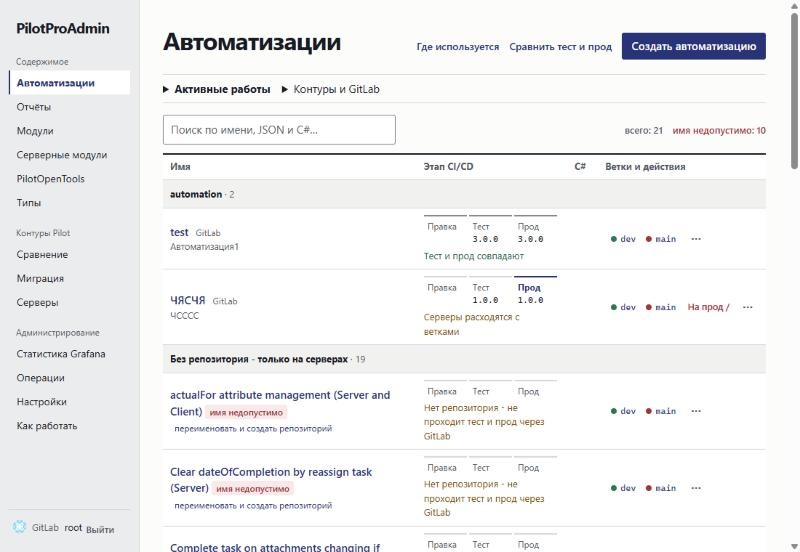

Одна автоматизация — один репозиторий в группе GitLab, подгруппы работают как папки. По каждой автоматизации в списке видны версии на тесте, стейдже и проде и сверка сервера с веткой. Автоматизации, которые есть только на серверах, собраны отдельным блоком: для них репозиторий создаётся одной кнопкой, а `main` и `dev` получают версии с прода и теста.

- Поиск по имени и по тексту JSON и C# на серверах и в ветках.
- «Где используется» показывает, в каких автоматизациях встречается тип, атрибут, состояние или действие. Проверяйте это перед изменением типа.
- «Сравнить тест и прод» сравнивает контуры построчно.

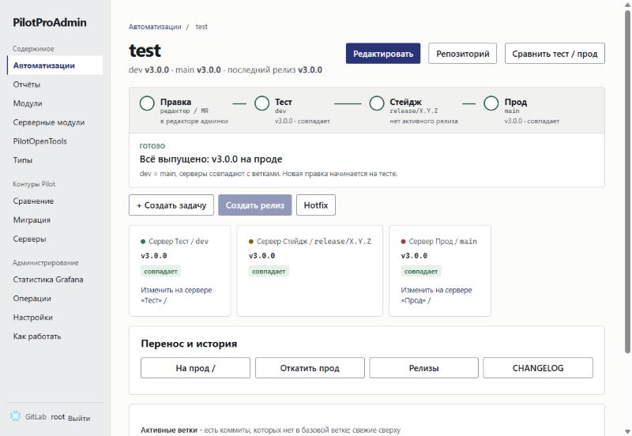

На странице автоматизации видно, на каком шаге она находится (правка, тест, стейдж, прод) и что делать дальше. Отсюда создаются задача, релиз и hotfix, выполняются перенос на прод, откат прода и просмотр релизов и `CHANGELOG`.

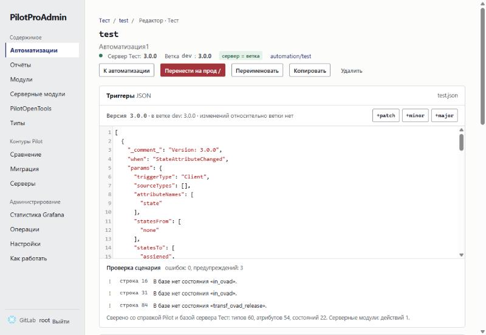

Редактор работает с JSON триггеров и C#-кодом. Кнопками `+patch`, `+minor` и `+major` поднимается версия. «Проверка сценария» сверяет сценарий со справочником Pilot и с базой сервера: типами, атрибутами, состояниями и серверными действиями. C# компилируется на Pilot ещё до отправки. Если пока редактор был открыт, файл в ветке или автоматизация на сервере изменились, сохранение отклоняется, и чужие правки не затираются.

### Отчёты

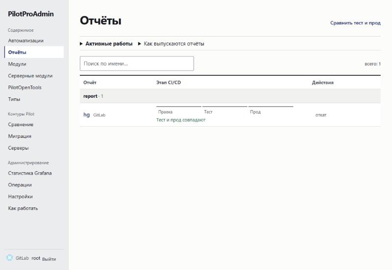

Отчёты `.repx` правят в дизайнере Pilot. При сохранении модуль [PilotReports](https://github.com/PilotOpenTools/PilotReports) отправляет файл в `dev` или в ветку hotfix. В админке видно, совпадает ли отчёт на тесте и проде с ветками. Отсюда же отчёт переносится в прод через MR и pipeline, откатывается и получает репозиторий, если его ещё нет.

### Клиентские модули

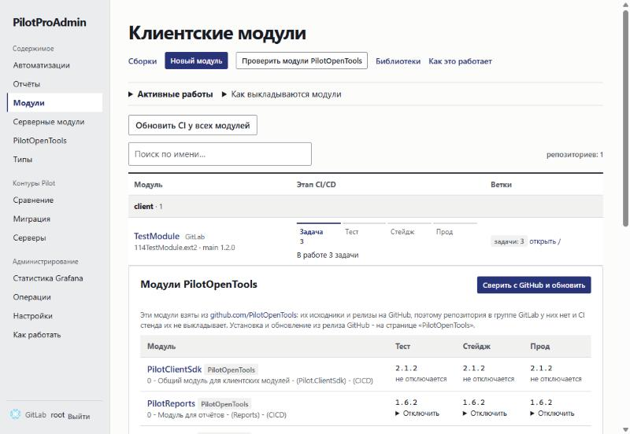

CI/CD для модулей клиента Pilot (`.ext2`). На сервер уходит артефакт, собранный в CI, а не исходники, и по номеру версии видно, какой коммит стоит на каком контуре.

- «Новый модуль» создаёт репозиторий с готовым каркасом: проект, точка входа, пример команды меню, шаблон CI, защита веток. Номер модуля подбирается свободный.
- Модули из [PilotOpenTools](https://github.com/PilotOpenTools) показаны отдельно, с версиями на каждом контуре.
- «Библиотеки» и «Сборки» задают правила для сторонних библиотек: общий модуль, разрешённый список или предупреждения. Проверку выполняет job CI `check_libraries`.
- Модуль можно отключить с указанием причины (у пользователей он пропадает сразу), включить обратно или удалить навсегда.

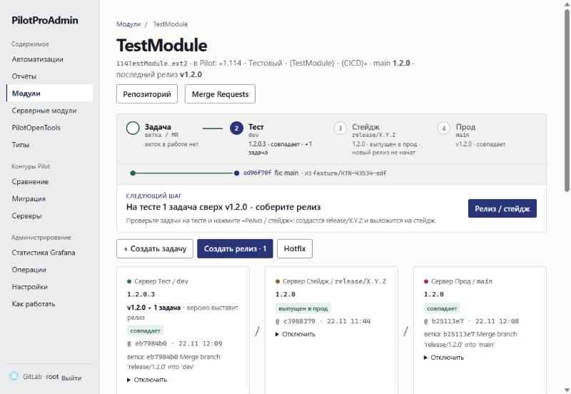

На странице модуля собраны задачи в `dev`, «Релиз / стейдж» (снимок `dev` или cherry-pick выбранных задач, версия, `CHANGELOG.md`, тег rc), «Выпустить в прод» с тем же артефактом, что был на стейдже, hotfix и откат прода на прошлый тег.

### Серверные модули

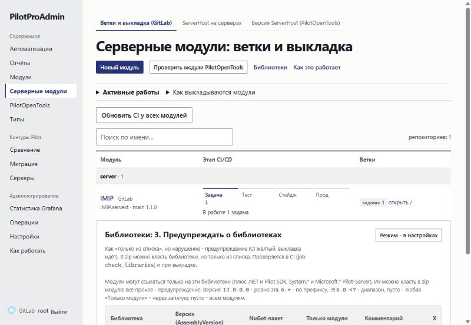

Модули Pilot-Server (`.servext`) работают по тем же веткам и с теми же кнопками. Записываются они в загрузчик ServerHost, который подменяет модуль без перезапуска сервера. На этой же странице:
- включение, отключение и откат модуля;
- журнал хоста;
- файл `debug.json` для [отладки на реальных данных](https://github.com/PilotOpenTools/PilotServerDebug);
- обновление самого ServerHost.

### PilotOpenTools

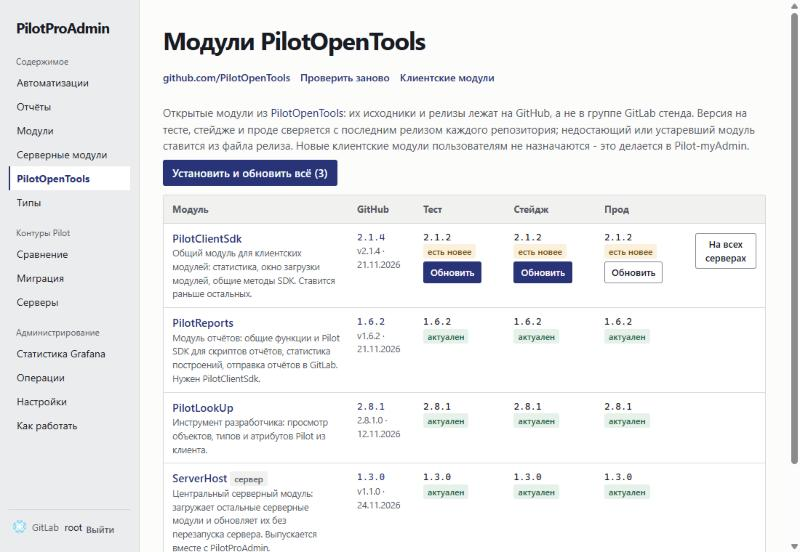

Страница сверяет открытые модули PilotClientSdk, PilotReports, PilotLookUp и ServerHost на тесте, стейдже и проде с последними релизами на GitHub. Отсутствующие и устаревшие модули ставятся одной кнопкой: на одном контуре, на всех серверах или все сразу. В закрытом контуре файлы релизов берутся из папки данных админки.

### Типы

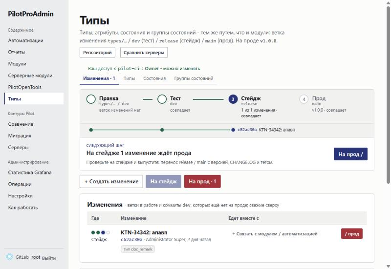

Типы, атрибуты, состояния и группы состояний хранятся как код в одном репозитории и проходят тот же путь: ветка изменения → `dev` (тест) → `release` (стейдж) → `main` (прод).

- На сервер пишутся только отличающиеся элементы, одним вызовом `UpdateMetadata`. Удаление атрибута и смена типа данных помечаются как опасные.
- Изменение типов можно связать с коммитом модуля или автоматизации, и тогда оно выпускается вместе с ними. Типы пишутся перед модулем и откатываются, если модуль не выпустился.
- На следующий контур можно переносить отдельные коммиты.

### Сравнение контуров

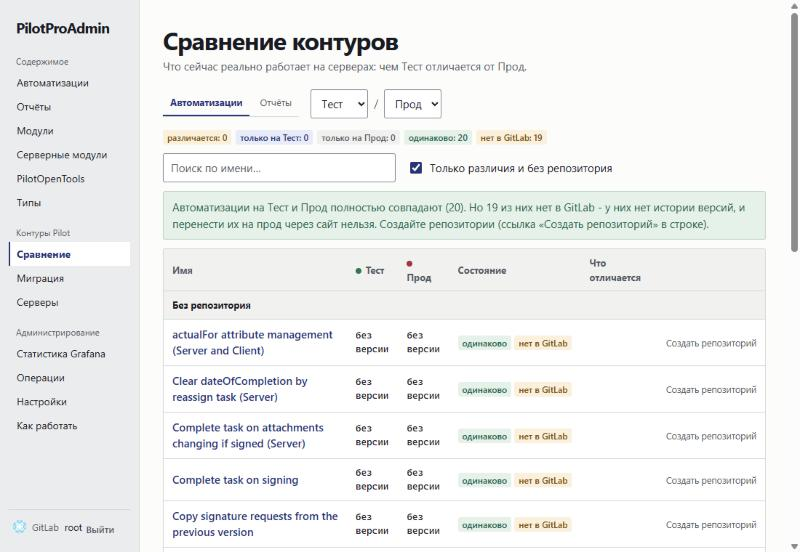

Показывает, что реально работает на серверах: чем тест отличается от прода, что есть только на одном контуре, у чего нет репозитория в GitLab. Сравнивать можно любую пару контуров, автоматизации и отчёты построчно.

### Миграция данных

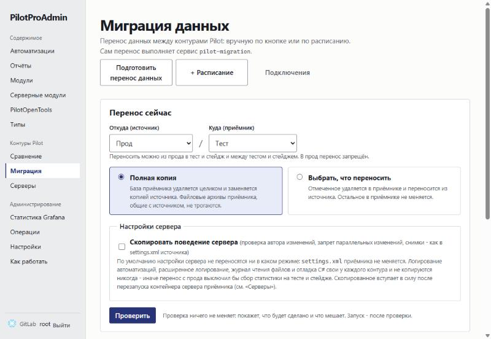

Интерфейс сервиса PilotMigration.

- **Перенос между контурами** вручную или по расписанию: полная копия или выбранные объекты. Из прода в тест и стейдж можно, в прод перенос запрещён.
- **Проверка перед запуском** ничего не меняет: она показывает, что будет сделано и что мешает.
- **Импорт присланной файловой базы** `.dbp` и выгрузка в файлы.
- **«Подготовить перенос данных»** выдаёт комплект для резервной копии или переноса стенда на другую машину.

[Подробно о миграции](proadmin/migration/README.md).

### Настройки серверов Pilot

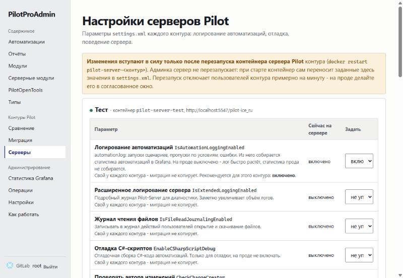

Здесь по контурам задаются параметры `settings.xml`: логирование автоматизаций, расширенное логирование, журнал чтения файлов, отладка C#, проверка автора изменений. Для каждого параметра видно текущее значение на сервере и рекомендация для контура. Значения применяются при перезапуске контейнера Pilot-Server.

### Операции

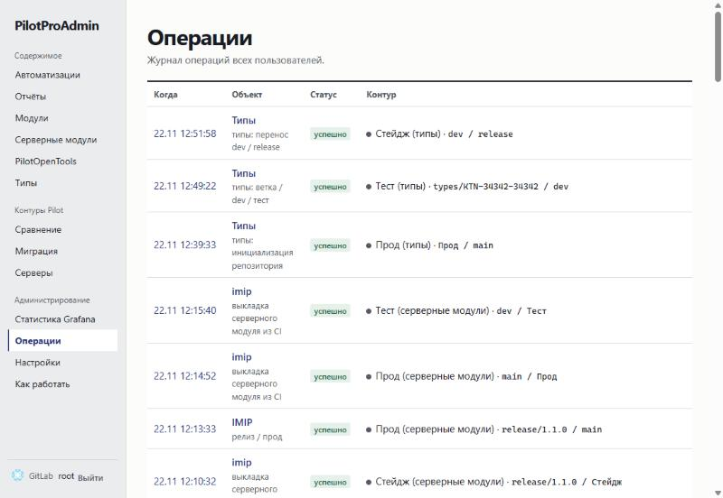

Журнал всех фоновых действий: выкладки, релизы, переносы, откаты, выкладки из CI. В каждой записи есть ссылки на Merge Request, pipeline и job, а у упавшего job — его лог. Обычный пользователь видит свои операции, администратор прода видит все.

### Как работать

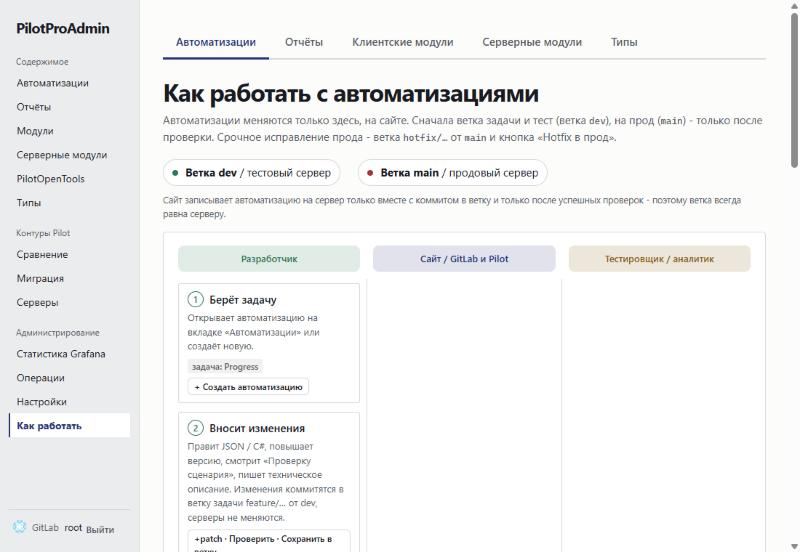

Пошаговые сценарии по ролям (разработчик, сайт / GitLab / Pilot, тестировщик) для каждого вида содержимого. Эту страницу можно дать пользователям вместо отдельной инструкции.

### Настройки

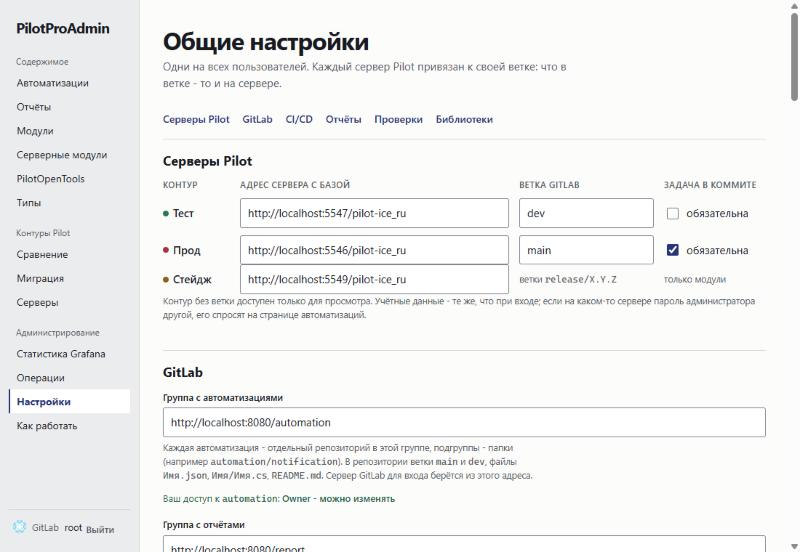

Общие настройки для всех пользователей:
- адреса серверов Pilot и их ветки;
- группы GitLab с автоматизациями, отчётами и модулями, репозиторий типов;
- режимы CI/CD (объединять ли тест и стейдж, нужен ли номер задачи в коммите, ревью);
- правила проверок и библиотек.

Под каждой группой показано, какие права у вас в ней есть.

### Ещё

- **Вход через GitLab** в браузере (OAuth) или по Personal Access Token. С серверами Pilot админка работает через служебные учётки из настроек.
- **Выкладка из GitLab CI.** Job `deploy_*` шаблона CI отправляет собранный модуль в админку. Админка проверяет токен задания в GitLab и ключ контура: из своей ветки разработчик не выложит модуль на стейдж или прод.
- **Статистика и логи в Grafana:** запуски и ошибки автоматизаций, построения отчётов, ошибки модулей, нагрузка серверов.
- **«Активные работы»** на каждой вкладке: какие проекты, ветки и коммиты менялись за период.
- Светлая и тёмная темы по настройке системы, работа на узком экране.

## Что поддерживается

- **Git-хостинг.** Полный CI/CD работает на GitLab. Через GitHub.com можно только публиковать типы на тест. [Матрица Git-хостингов](docs/git-hosting.md).
- **Pilot-Server.** Монолит или кластер: админка подключается к существующему серверу или разворачивает монолит сама. [Варианты развёртывания](docs/deployment.md).
- **Платформы.** Docker на Windows (Docker Desktop) и Linux (Docker Engine). Без Docker работает [Windows Portable](docs/windows-portable.md).

## Установка

Всё берётся из [релиза на GitHub](https://github.com/PilotOpenTools/PilotProAdmin/releases/latest): скачайте `PilotProAdmin-vX.Y.Z-lite.zip`, распакуйте его в постоянную папку и запустите `install.ps1`. Установщик спросит, что поставить на этой машине (GitLab, Grafana, контуры Pilot), а что подключить существующим.

- [Быстрый старт](docs/getting-started.md): установка на Windows и Linux, ключ первого входа, перенос из резервной копии.
- [Установка и устройство пакета](docs/installation-package.md): что лежит в релизе, как устроен установщик, роли, обновление, из чего собирается релиз.

## Репозиторий

| Папка | Что в ней |
|---|---|
| [`proadmin/`](proadmin/README.md) | Веб-админка (ASP.NET, Razor Pages) и сервис миграции `migration/` |
| [`stack/`](stack/README.md) | Установочный комплект (`Install/`), мониторинг и сборщики статистики (`metrics/`) |
| [`gitlab/`](gitlab/README.md) | Общие проверки CI автоматизаций и отчётов (`ci-checks/`) |
| [`client-modules/`](client-modules/README.md) | Тестовый клиентский модуль и шаблон CI клиентских модулей |
| [`server-extensions/`](server-extensions/README.md) | Загрузчик ServerHost, пример серверного модуля и шаблон CI |
| [`docs/`](docs/index.md) | Документация сайта |
| `scripts/` | Сборка релиза |

Модули в отдельных репозиториях: [PilotClientSdk](https://github.com/PilotOpenTools/PilotClientSdk) (общий клиентский модуль и NuGet-пакет), [PilotReports](https://github.com/PilotOpenTools/PilotReports) (модуль отчётов), [PilotServerDebug](https://github.com/PilotOpenTools/PilotServerDebug) (отладка серверных модулей). Сборка и проверка изменений описаны в разделе [Разработка](docs/development.md).
