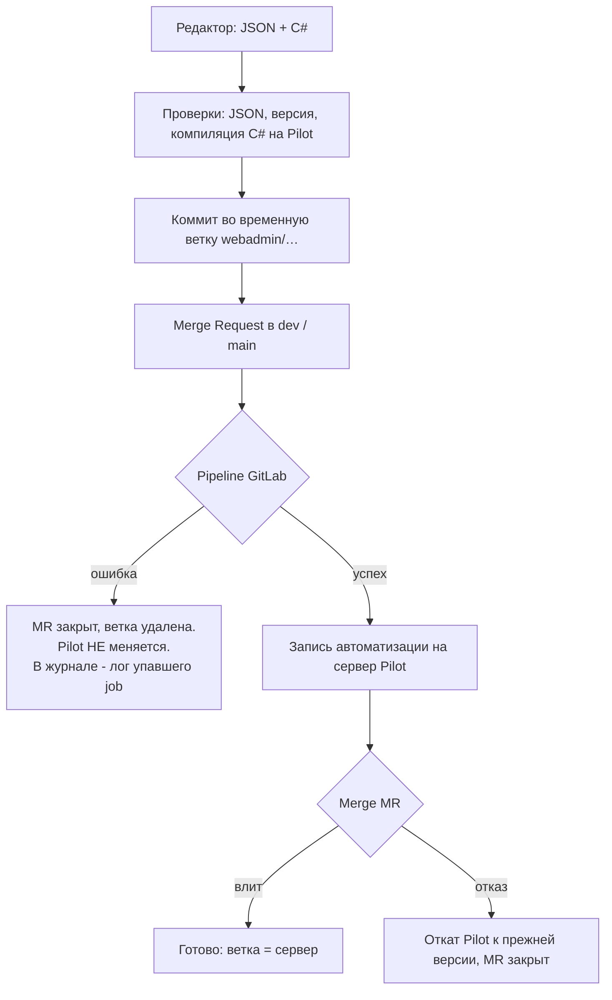

# PilotProAdmin - веб-админка Pilot

Веб-админка стенда. GitLab в ней источник правды: автоматизации, отчёты, клиентские и серверные модули и типы попадают на серверы Pilot из веток GitLab, как правило после успешного pipeline. Исключения описаны ниже: путь «содержимое уже лежит в ветке» (запись без нового pipeline), режим «тест и стейдж вместе» (стейдж пишется после merge без отдельного pipeline) и аварийный обход «без CI» в настройках (выключен по умолчанию). Изменяющие действия требуют доказанных прав в GitLab: без подключённого GitLab или при ошибке определения роли они запрещены.

| Раздел | Что делает | Описание |
|---|---|---|
| Автоматизации | создание, правка, перенос между контурами, откат | ниже |
| Отчёты | создание репозитория, перенос в прод, откат. Сами отчёты правят в дизайнере Pilot | [Отчёты](#отчёты), [README Reports](../Reports/README.md) |
| Модули, Серверные модули | где сейчас модуль, что дальше, ветки, выкладка, библиотеки | [Модули](#модули), [Серверные модули](#серверные-модули) |
| Сравнение | тест и прод, серверы и ветки, построчно | `/Compare` |
| Типы | типы, атрибуты и состояния как код | [Типы](#типы-конфигурация-базы-как-код) |
| Миграция | интерфейс сервиса миграции | [README миграции](migration/README.md) |
| Серверы | параметры `settings.xml` по контурам | [Серверы](#серверы-настройки-settingsxml) |
| Операции | журнал фоновых операций со ссылками на MR, pipeline и job; обычный пользователь видит только свои операции, администратор прода - все | `/Jobs` |
| Как работать | пошаговые сценарии по ролям для каждого вида содержимого | `/Process`, для пользователей |
| Настройки | адреса серверов и групп GitLab, режимы CI/CD | `/Settings` |

Блок «Активные работы» на вкладках показывает, что менялось за период: проекты, ветки, коммиты.

В [общем макете Razor](src/ProAdmin/Pages/Shared/_Layout.cshtml) боковая панель объединяет разделы, аккаунты и доступ к контурам. Текущий раздел определяется через `ViewData["Section"]`. На узком экране панель раскрывается кнопкой «Разделы и сессия». В каталогах сразу видны поиск и таблица, а «Активные работы» раскрываются по запросу. Широкие таблицы прокручиваются в своей области. Светлая и тёмная темы используют токены в [site.css](src/ProAdmin/wwwroot/css/site.css) и следуют настройке системы.

| Содержимое | Тест | Стейдж | Прод |
|---|---|---|---|
| Автоматизации | `dev` | `release/X.Y.Z` или вместе с тестом, см. ниже | `main` |
| Отчёты | `dev` | нет, при настройке «Отчёты делают на стейдже» `dev` пишется на стейдж вместо теста | `main` |
| Модули, клиентские и серверные | `dev` | `release/X.Y.Z` | `main` |
| Типы | `dev` | `release` | `main` |

## Как проходит автоматизация

Список автоматизаций - одна таблица: у каждой строки версии и сверка сервер / ветка, имя ведёт на страницу автоматизации (`/Automations/Item`) с контурами, ветками и следующим шагом.

1. **Правка.** В редакторе «Сохранить в ветку» коммитит в `feature/KTN-…` от `dev`, а на проде в `hotfix/…` от `main`. При изменении JSON или C# версия должна быть выше версии в последнем коммите целевой ветки. Для новой ветки версия берётся из `dev` или `main`. Серверы при этом не меняются.
2. **Тест.** «Влить / тест» на странице автоматизации отправляет ветку в `dev` и на тестовый сервер по схеме ниже, затем удаляет её. Если `dev` ушёл вперёд, сначала «Обновить из dev».
3. **Стейдж и прод.** Режим задан в настройках, раздел «CI/CD автоматизаций»:
   - **Тест / стейдж / прод**, как у модулей: «Релиз / стейдж» создаёт `release/X.Y.Z` от `dev` и записывает её на стейдж, «Выпустить в прод» переносит релиз. Версия берётся из `dev` и должна быть выше, чем в `main`;
   - **Тест и стейдж вместе** (включается настройкой «Режим CI/CD автоматизаций»): «Влить / тест» сразу записывает то же на стейдж, на прод переносится `dev`, веток `release/*` нет.
4. **Hotfix.** «Hotfix в прод» переносит ветку `hotfix/…` в `main` и на прод.

Кнопка «Отправить» в редакторе отправляет правку сразу в ветку контура, минуя ветку задачи.

## Как работает «Отправить»



* Если содержимое уже есть в ветке (например, «загрузить из ветки и применить»), коммит не нужен: автоматизация сразу пишется на сервер, без нового pipeline. В режиме «тест и стейдж вместе» стейдж пишется после merge без отдельного pipeline, а сбой записи на стейдж остаётся предупреждением в журнале.
* Если пока редактор был открыт, файл в ветке или автоматизация на сервере изменились, отправка отклоняется. Это защита от затирания чужих правок.
* Одновременно по одной автоматизации в одном контуре может идти только одна операция.
* Для прода есть кнопка **«Из ветки dev (Тест)»**: она переносит проверенную на тесте версию в редактор прода.
* Эту же схему использует «Влить / тест» и перенос на прод.

## Структура в GitLab

**Одна автоматизация = один репозиторий** в группе автоматизаций. Подгруппы работают как папки:

```text
automation/                     / группа из настроек (http://localhost:8080/automation)
├── NotifyOnApproval/           / репозиторий автоматизации, ветки main и dev
│   ├── NotifyOnApproval.json   / поле Triggers
│   ├── NotifyOnApproval/NotifyOnApproval.cs  / поле CSharpCode (если есть)
│   └── README.md               / описание
└── notification/               / папка = подгруппа automation/notification
    └── MailOnTaskAssigned/
```

**Имя проекта** GitLab (Project name) совпадает с именем автоматизации в Pilot: по нему сервер сопоставляется с GitLab. Имя может быть русским и с пробелами (буквы, цифры, пробел, `_ - . +`). Путь проекта (Project slug) создаётся транслитом и на сопоставление не влияет, например «Уведомление о задаче» / `uvedomlenie-o-zadache`. Для репозиториев, созданных раньше, совпадение по пути тоже засчитывается. Список автоматизаций разбит по папкам. Автоматизации, у которых есть только версия на сервере, собраны в блоке «Без репозитория».

### Поиск и «где используется»

Поле поиска в списке автоматизаций ищет по имени и по тексту JSON и C# на серверах, а JSON ещё и в ветках `dev` и `main`. Под найденной строкой видно, в каком источнике совпадение и кусок текста вокруг него. Лишних запросов поиск не делает: тексты приходят вместе со списком.

Страница **«Где используется»** (`/Automations/Usage`, ссылки есть в списке автоматизаций и на вкладках «Типы» и «Состояния» раздела «Типы») показывает, в каких автоматизациях встречается тип, атрибут, состояние или действие: сервер или ветка и конкретный параметр. Перед изменением типа проверяйте его здесь.

* Имена берутся из параметров по справочнику `AutomationSchema` и из выражений вида `new.attr.executor`. Параметры произвольной структуры (`completionStateConfig`) не разбираются, их проверяют поиском по тексту.
* В C# имя ищется как отдельное слово, поэтому возможны случайные совпадения: такие места помечены «встречается в тексте». C# читается только с серверов.
* Если сервер или GitLab не прочитан либо JSON сценария не разбирается, страница об этом предупреждает: отсутствие имени в таком списке ничего не доказывает.

### Создание автоматизации

Кнопка **«+ Создать автоматизацию»** спрашивает имя, папку (подгруппу) и описание. Затем создаётся репозиторий с ветками `main` и `dev`. В обеих ветках лежат `Имя.json` с заготовкой - массивом с одним элементом `[ { "_comment_": "Version: 1.0.0" } ]` - и `README.md` с описанием. Заготовку нельзя отправить на сервер, пока в ней нет триггера. Как только триггер появится, версия переедет в него.

Если автоматизация с таким именем уже есть на серверах Pilot, можно отметить импорт. Тогда `main` получит версию с прода, а `dev` - версию с теста. Так существующие автоматизации переносятся в GitLab. Новую папку создайте в GitLab как подгруппу группы автоматизаций, после этого она появится в списке выбора.

## Отчёты

Вкладка **«Отчёты»** включается, когда в настройках указана **группа GitLab с отчётами** (например `http://localhost:8080/reports`, на том же сервере GitLab, что и автоматизации).

| Ветка GitLab | Сервер Pilot |
|---|---|
| `dev`  | тестовый, а при настройке «Отчёты делают на стейдже» стейдж |
| `main` | продовый |

Стейджа и веток `release/*` у отчётов нет.

* **Один отчёт = один репозиторий** в группе отчётов, подгруппы - папки. **Имя проекта = имя отчёта в Pilot**. Регистр, `ё/е` и символы, недопустимые в имени проекта GitLab (`( ) # " :` …), при сравнении не учитываются. Путь проекта (slug) - любой.
* Файл отчёта - `Имя отчёта.repx` в корне. Для старых репозиториев подходит и единственный `.repx` в репозитории.
* **Отчёты в админке не редактируются.** Их меняют в дизайнере Pilot. При сохранении модуль Reports предлагает отправить `.repx` в `dev` или, для исправления прода, в ветку `hotfix/<дата-время>` от `main`: репозиторий ищется по имени отчёта, ссылка на GitLab в скрипте не нужна.
* **Список:** по каждому отчёту - «Тест / dev», «Прод / main» (совпадает / отличается / нет в ветке / нет на сервере) и «dev / main» (ждёт прода).
* **«На прод /»:** Merge Request `dev` / `main` (открытый MR переиспользуется), ожидание pipeline, запись `.repx` на продовый сервер (новой версией отчёта; если на проде отчёта нет - создаётся в выбранной папке), merge. Если merge не удался, сервер откатывается: прежняя версия или созданный отчёт уходит в корзину. Ветка `dev` не удаляется.
* **Hotfix:** на странице отчёта (`/Reports/Item`) «Hotfix в прод /» переносит ветку `hotfix/…` в `main` и на прод, затем «/ В тест» возвращает исправление в `dev`.
* **Нет репозитория:** у отчёта в списке есть ссылка «создать репозиторий». Нужно выбрать папку (подгруппу) - подходящая подбирается по папке отчёта в Pilot, по номеру вроде `01-…`. `main` получает отчёт с прода, `dev` - с теста.
* **Вход в Pilot.** Отчёты - объекты базы, поэтому админка входит в базу **пользователем** с кодом лицензии из настроек (по умолчанию 100). Если учётка, с которой вы вошли, не подходит, вкладка спросит логин и пароль пользователя базы для каждого сервера.
* Сравнение с сервером идёт по содержимому `.repx` с точностью до BOM и переводов строк. Файлы с сервера кэшируются по версии, поэтому повторно скачиваются только новые версии.

## Модули

Вкладка **«Модули»** - CI/CD клиентских модулей Pilot по схеме Pilot-BIM. Включается, когда в настройках указана **группа GitLab с клиентскими модулями** (например, `http://localhost:8080/client-modules`; значение задаётся на странице «Настройки»). Для стейджа нужен ещё **сервер стейджа** (`http://localhost:5549/pilot-ice_ru`).

| Ветка GitLab | Сервер Pilot |
|---|---|
| `dev` (задачи `feature/KTN-…` вливаются squash'ем) | тестовый |
| `release/X.Y.Z` (теги `vX.Y.Z-rc.N`) | стейдж |
| `main` (теги `vX.Y.Z`) | продовый |

* **На сервер уходит артефакт CI**, а не исходники: сайт ждёт успешный pipeline коммита, скачивает zip из job `build_module` (настройка) и пишет его новой версией объекта `Extension`. Причина версии - `X.Y.Z · ветка @ коммит - задачи`. Версия модуля везде - **три числа X.Y.Z** (четвёртое число AssemblyVersion .NET, равное `.0`, не показывается и не пишется; ненулевое остаётся видимым - это другая сборка), по ней видно, какой коммит на каком сервере. Права (назначение пользователям) не меняются.
* **Список:** каждый репозиторий группы против трёх серверов: совпадает / ветка впереди / та же версия (выложен вручную) / другая версия / нет на сервере / нет релиза. Модуль в Pilot находится по `AssemblyProduct` = «Наименование», коду в скобках или имени проекта. Модули серверов без репозитория - отдельным списком.
* **Отключение и удаление (клиентские модули):** в карточке контура на странице модуля, у модулей без репозитория - в списке на вкладке. «Отключить» (нужна причина) переносит объект в корзину Pilot: права и версии сохраняются, меню и команды у пользователей пропадают сразу, полностью модуль выгружается при перезапуске клиента, папка в его кэше удаляется при следующем запуске. «Включить» возвращает объект в прежнюю папку. «Удалить навсегда» доступно только для отключённого модуля, требует имя модуля и причину; объект удаляется со всеми версиями, репозиторий в GitLab остаётся. Отключённые модули хранятся в `data/disabled-modules.json`: выкладка такого модуля на этот контур, в том числе из CI, завершается ошибкой, иначе появился бы второй объект. Общий модуль и модули из папки `Preload` не отключаются. Действия записываются в «Операции».
* **Страница модуля:** серверы и ветки; задачи / `dev` («Влить / тест»: squash merge + выкладка на тест); релиз («Релиз / стейдж» - MR `release-prep/X.Y.Z / release/X.Y.Z`, где `release-prep` - снимок головы `dev` (все задачи) или cherry-pick только выбранных задач от `main`, затем merge, версия и `CHANGELOG.md`, стейдж, тег rc; «Влить / стейдж» - повтор или багфикс; «Выпустить в прод» - MR `release / main`, тот же артефакт, что на стейдже, merge с откатом прода при неудаче, тег и Release, обратное слияние в `dev`; «Отменить релиз»); hotfix (ветка от `main`, проверка на стейдже, «Hotfix в прод» - патч-версия, тег, синхронизация в `dev` и активный release); откат прода на прошлый тег.
* **Подключить репозиторий:** создаёт `dev` от `main` и кладёт в `dev` шаблон `.gitlab-ci.yml` (проверка схемы веток в MR + сборка zip). Копия шаблона - `Клиентские модули/ci-template/`.
* **Вход в Pilot** - как у отчётов: пользователь базы (с правами на папку расширений) с кодом лицензии из настроек; своя учётка на сервер, если учётка входа не подходит.

Подробно - [Клиентские модули/README.md](../Клиентские%20модули/README.md).

## Серверные модули

Вкладка **«Серверные модули»** (`/Modules?kind=server`) - те же ветки и кнопки, что у клиентских модулей, но zip записывается не в объект `Extension`, а в загрузчик ServerHost контура, который подменяет модуль без перезапуска сервера. Там же включение, отключение и откат модуля, журнал хоста и файл `debug.json` для локальной отладки. Архив при ручной загрузке уходит на сервер кусками по 512 КБ прямо из потока формы и целиком в память админки не читается.

**Обновление самого ServerHost.** На странице «Серверные модули» контура показана версия хоста, записанная в базе (серверное расширение `$PilotServerExtension` с именем ServerHost), и форма загрузки zip новой версии. Админка проверяет, что в корне архива лежит `ServerHost.servext.dll`, а версия сборки не ниже записанной (понижение - только с отметкой «Понизить версию»), записывает новую версию в объект хоста новым снимком, обновляет поле «Additional» в том же формате, что у остальных расширений («Версия X.Y.Z - Размер N КБ»), и пишет операцию в «Операции». Pilot-Server читает хост один раз при старте, поэтому новая версия вступает в силу только после перезапуска сервера Pilot (всех узлов в кластере). Действие доступно только вошедшему администратором Pilot контура «Прод» с правами Developer и выше на группу серверных модулей; запись идёт учётной записью администратора базы контура, как и остальные операции страницы. Если объекта хоста в базе нет, страница показывает инструкцию первой установки.

Группа GitLab задаётся настройкой «Группа с серверными модулями» (например, `http://localhost:8080/server-extensions`; значение задаётся на странице «Настройки»). Подробно - [Серверные расширения/README.md](../Серверные%20расширения/README.md), [ServerHost](../Серверные%20расширения/ServerHost/README.md), [Debug](../Серверные%20расширения/Debug/README.md).

### Выкладка модулей из GitLab CI

Job `deploy_*` шаблона CI (`POST /api/ci/modules/deploy`, серверные - `/api/ci/server-modules/deploy`) отправляет в админку zip, собранный job `build_module`. Запрос анонимен для cookie-входа, но обязан нести **два доказательства**:

1. `X-Job-Token` - `$CI_JOB_TOKEN` задания. Админка проверяет его в GitLab (`GET /api/v4/job` с заголовком `JOB-TOKEN`, тайм-аут 15 с, без редиректов) и берёт из ответа ветку, коммит, pipeline, проект и автора. Поля формы `ref`, `sha`, `project`, `user`, `pipeline_url` больше не источник истины: если они переданы и не совпадают с проверенными значениями, ответ 400. Ошибка или не-200 от GitLab - 401. Проект обязан лежать в группе модулей этого вида (клиентские - «Группа с клиентскими модулями», серверные - «Группа с серверными модулями»), иначе 403.
2. `X-Deploy-Key` - ключ контура, выведенного из **проверенной** ветки: `dev` / test, `release/*` / stage, `main`/`master` / prod. Ключи раздельные: `MODULES_DEPLOY_KEY_TEST`, `MODULES_DEPLOY_KEY_STAGE`, `MODULES_DEPLOY_KEY_PROD` (`App__CiDeploy__Keys__test|stage|prod`), в GitLab группы модулей - `DEPLOY_KEY_TEST` (Masked), `DEPLOY_KEY_STAGE` и `DEPLOY_KEY_PROD` (Masked и Protected). Ветки `main` и `release/*` защищены (merge: Maintainers; push: для `main` - No one, для `release/*` - Maintainers: админка от имени выпускающего создаёт `release/X.Y.Z` и коммитит в неё версию и `CHANGELOG.md`, при «No one» GitLab это запретит; в `main` админка только вливает Merge Request, а `.gitlab-ci.yml` в `dev` вносит тоже через Merge Request), поэтому разработчик без права выпуска ключей stage и prod из CI своей ветки не получит. Без ключа контура ответ 503 с названием нужной переменной.

Защита `main`. Цель: на `main` попадает только проверенный код, поэтому автоматическая выкладка на прод из него безопасна. Прямой push в `main` запрещён, влить можно только Merge Request, а в проектах с CI - только с зелёным pipeline. Сейчас это так: у проектов модулей (их обрабатывает установщик, шаг GitLab после установки) и у новых репозиториев автоматизаций и отчётов, созданных админкой. У репозиториев автоматизаций и отчётов, созданных раньше, `main` не защищается (в отчётах установщик включает только «Pipelines must succeed»): защитите его в GitLab вручную. Новые репозитории автоматизаций и отчётов админка защищает сама сразу после создания (push - никто, merge - Maintainer; включает и «Pipelines must succeed»). Для групп модулей и отчётов установщик ещё задаёт такую же защиту по умолчанию новым проектам, созданным прямо в GitLab: там push и merge - Maintainer, так как «No one» GitLab в этой настройке не принимает; кроме того, включён `developer_can_initial_push`, чтобы админка (роль Developer) могла сделать первый коммит в новый проект. Переименование автоматизации коммитит в `main` напрямую, поэтому админка на время этого коммита снимает защиту и сразу возвращает её; для этого нужна роль Maintainer.

Прежний общий ключ `MODULES_DEPLOY_KEY` (`App__CiDeploy__ApiKey`, в GitLab - `DEPLOY_KEY`) принимается только для контура test и только если `MODULES_DEPLOY_KEY_TEST` не задан; для stage и prod не принимается никогда. После перехода удалите его.

Проверки, которые ничего не меняют на серверах (`check-libraries`), требуют только `X-Job-Token` с той же проверкой проекта и группы.

Перебор ограничен: после 10 запросов без job-токена или с токеном, который GitLab не подтвердил, с одного адреса за 5 минут такие запросы с этого адреса получают 429 на 5 минут (если админка за обратным прокси, включите `ADMIN_TRUST_PROXY`, иначе адрес клиента не виден). Запросы с подтверждённым job-токеном блокировка адреса не затрагивает: задания раннера приходят с одного адреса. Неверные ключи выкладки считаются по проекту подтверждённого задания: после 10 неверных ключей за 5 минут выкладки этого проекта получают 429 на 5 минут, остальные проекты работают. Задание проекта вне группы модулей получает 403 и в счётчик не идёт. Счётчик проекта общий для трёх контуров, отсутствующий `X-Deploy-Key` считается неверным ключом. С заблокированного адреса админка проверяет в GitLab не больше 60 токенов за 5 минут. Перебор ключа можно продолжить из другого проекта группы, поэтому ключи контуров должны быть длинными случайными строками (установщик создаёт такие сам). Недоступность GitLab при проверке job-токена в счётчик не идёт (ответ 503). Служебные учётки Pilot для записи по контурам - `MODULES_DEPLOY_<КОНТУР>_LOGIN` / `_PASSWORD`. Переход со старой схемы: задайте три ключа в `.env` и три переменные в GitLab, обновите `.gitlab-ci.yml` модулей кнопкой «Обновить CI» (шаблон уже шлёт `X-Job-Token` и ключ контура).

### Библиотеки модулей (Настройки / «Библиотеки модулей»)

Режим выбирается отдельно для клиентских и серверных модулей (`data/assembly-spec.json` и `data/assembly-spec-server.json`, с историей правок;
менять может Developer+ группы модулей этого вида):

1. **Запретить доп. библиотеки** - все библиотеки ставит один выбранный общий модуль. В zip остальных модулей - только своя главная сборка,
   а ссылаться она может только на библиотеки общего модуля (плюс .NET, `Ascon.Pilot.*`, «есть в клиенте Pilot»). На страницах «Модули» и
   «Серверные модули» - нередактируемая таблица: общий модуль и его библиотеки с версиями на тесте / стейдже / проде. Клиентский общий модуль
   кладут в папку расширений `Preload`; серверный - ServerHost ищет недостающие dll модуля в папках других модулей (нужна свежая версия хоста).
2. **Разрешать библиотеки только из списка** - модуль может ссылаться только на библиотеки из списка (в указанных версиях), в zip доп. библиотек
   быть не должно. Список редактируется прямо на страницах «Модули» / «Серверные модули» (карточка «Библиотеки»).
3. **Предупреждать о библиотеках** - как 2, но нарушение - предупреждение, и в zip можно класть библиотеки из списка.

Проверяется состав zip и ссылки главной сборки (читаются из метаданных). Режимы 1 и 2 - ошибка: job `check_libraries` шаблона CI красный
(`POST /api/ci/modules/check-libraries`, `/api/ci/server-modules/check-libraries`; хватает токена задания `X-Job-Token`, ключ выкладки не нужен), выкладка на любой контур запрещена.
Режим 3 - предупреждение (job жёлтый, код выхода 3). Строка списка с «только модули» - исключение для перечисленных модулей (например native-dll в zip).
Серверным модулям `System.*` / `Microsoft.*` / `Ascon.Pilot.*` в zip не мешают - хост их выбрасывает. Прежний режим «каждый модуль со своими
библиотеками» при чтении становится режимом 3.

`/Modules/Assemblies` («Сборки», клиентские модули) - полный список правил: **разрешена**, **запрещена**, **есть в клиенте Pilot** (кнопка
«Добавить библиотеки клиента Pilot» заносит 116 сборок клиента 26.x), версии файла; проверка zip без выкладки и «Состав модулей на сервере» -
dll всех модулей контура, версии, конфликты, папка. Версии: `13.0.0.0`, `6.*`, `>=6.0 <7`, варианты через `;`. Поле «NuGet-пакет» - «Пакет версия».

Как это работает в клиенте (проверено на тесте 2026-10-10, Test-module 1.3.0 + ClientSdk 2.1.0): клиент сначала грузит модули из папки `Preload`
и ждёт их, потом остальные. Каждый модуль подписывает `AssemblyResolve`, который ищет недостающую dll **по имени, без версии** - в папке клиента,
потом в папке своего модуля; обработчики общие, поэтому dll общего модуля находят все. Версию задаёт общий модуль (модуль, собранный против
Humanizer 2.13, получил 2.14).

Всегда проверяется: чужой модуль (`*.ext2.dll` / `*.servext.dll`) внутри модуля и два `[Export]` контракта с одиночным импортом
(`IMenu<…>`, `IToolbar<…>`): клиент импортирует один, при двух не подключает ни одного.

## Типы (конфигурация базы как код)

Вкладка **«Типы»** - типы, атрибуты, состояния и группы состояний в одном репозитории GitLab (настройка **«Репозиторий с типами»**,
например `http://localhost:8080/pilot-config/types`). Без настройки вкладка только сравнивает серверы (`/Types/Compare`).

| Ветка | Сервер | Как меняется |
|---|---|---|
| `dev` | тестовый | «+ Новое изменение» создаёт ветку `types/KTN-…` от `dev`, редактор / «Сохранить в ветку» (каждое сохранение - коммит), затем «Влить / тест»: MR со squash, pipeline, запись `dev` на тест |
| `release` | стейдж | вместе со связанным модулем или «/ стейдж»: выбранные коммиты (cherry-pick) / MR / pipeline / запись на стейдж / merge (не удался - откат стейджа) |
| `main` | прод | вместе со связанным модулем или «/ прод»: выбранные коммиты + версия в `config.json` и раздел `CHANGELOG.md` / MR / pipeline / прод / merge / тег `vX.Y.Z` и Release |

* **Файлы:** `types/<имя>.json` (тип с атрибутами), `states/<имя>.json`, `state-machines/<заголовок>.json`, `config.json` (версия), `CHANGELOG.md`.
  Элементы сопоставляются с базой по имени, Id на каждом сервере свои; ссылки внутри конфигураций - `{{state:имя}}` / `{{machine:заголовок}}`.
* **Запись на сервер** - план по свежим метаданным и один `UpdateMetadata` (не `ImportConfiguration` - тот портит данные). Пишутся только отличающиеся
  элементы; элементы сервера, которых нет в репозитории, не трогаются. Новый тип - Id = max+1; удаление типа - `isDeleted` (совсем удалить Pilot не даёт).
  Редактор предлагает свободный порядок для нового типа. Перед слиянием в `dev` проверяется порядок типов в результате слияния и в метаданных Pilot.
  Удаление атрибута и смена типа данных помечаются как опасные. Откат - возврат затронутых элементов, созданные типы помечаются удалёнными.
* **Перенос по одному коммиту:** в `dev` каждая влитая ветка - один коммит; на странице переноса отмечаются нужные. Перенесённые узнаются по пометке
  `(cherry picked from commit …)`, служебные коммиты версии в другие ветки не переносятся. Если коммит зависит от невыбранного - cherry-pick
  не пройдёт, и операция остановится, ничего не изменив.
* **Вместе с модулем:** изменение типов связывается с коммитом модуля или автоматизации (`/Types/Link`). Релиз на стейдж переносит связанные изменения с собой. «Выпустить в прод» пишет типы **перед** модулем; модуль не выпустился - типы откатываются, выпустился - MR типов вливается, тег `vX.Y.Z`. Выкладка на прод из CI (`deploy_prod`) такие изменения не пропускает: при связанных типах она останавливается и просит выпустить кнопкой на странице модуля.
* **Инициализация:** пустой проект / «Инициализировать» (снимок выбранного сервера, обычно прода, в `main`; `release`, `dev` от `main`; защита веток;
  CI-проверка `ci/validate.py`). Если тест правили напрямую - «Сервер Тест / ветка изменения»; на стейдже и проде - «Записать ветку на сервер».
* **Вход в Pilot** - администратор сервера (как для автоматизаций); для стейджа - та же учётка входа.

## Версии

Версия хранится в поле `_comment_` первого триггера. Там только номер, описание автоматизации лежит в README репозитория:

```json
[
  { "_comment_": "Version: 1.0.2", "when": "…", "params": { … }, "then": [ … ] }
]
```

Отдельной записи `{ "_comment_": … }` без `"when"` быть не должно: клиент Pilot падает на ней с `ArgumentNullException (key)` в `AutomationEventHandler.RebuildSnapshot`. Если такая запись есть, при отправке сайт переносит её в первый триггер (`AutomationVersion.ToStorageLayout`). Корневой объект при этом оборачивается в массив. Линтер предупреждает о такой записи и не пропускает её, если триггеров нет. CI (`check_automations.py`) требует `"when"` у каждого элемента.

Так версию видно и в GitLab, и на сервере Pilot (в myAdmin и в колонке «Сервер» списка). Версия общая для JSON и C#: правка только C# тоже требует её повышения.

* **Редактор:** над JSON показаны версия в редакторе и в ветке, а также статус «повышена / не повышена». Кнопки **+patch / +minor / +major** повышают версию относительно ветки; повторное нажатие номер не «накручивает». Если версии нет, она добавляется первым полем первого триггера. Отдельная запись старого формата переносится туда же.
* **Отправка:** если есть изменения, а версия не выше, чем в ветке, отправка отклоняется.
* **Перенос на прод:** версия в `dev` должна быть выше, чем в `main`. Если в `main` выше, значит, прод меняли мимо теста, и перенос блокируется.
* **Теги:** после каждого попадания версии в `main` создаются тег `vX.Y.Z` на коммите `main` и GitLab Release с задачей и описанием. При импорте с прода тег получает версия, которая сейчас на проде. Если такой тег уже есть на другом коммите, в журнале будет предупреждение.
* **Список:** колонки «Сервер / dev / main» и пометки «ждёт прода» (в `dev` новее) и «выше dev» (в `main` новее).
* **CI** (проект `pilot-ci/checks`, исходники в `gitlab/ci-checks/`): версия указана и повышена; в MR в `dev` она не ниже, чем в `main`.
* **Откат прода:** пункт «Откатить прод» (меню «⋯» в строке автоматизации) берёт содержимое выбранного релиза `vX.Y.Z` и отправляет его в `main` **новой** версией (max + patch) обычным путём: MR / pipeline / сервер / merge / тег. Коммиты не отменяются, версии только растут.

## Журнал изменений (CHANGELOG.md)

В каждом репозитории автоматизации и отчёта есть `CHANGELOG.md` (по мотивам [keepachangelog.com](https://keepachangelog.com/ru/1.1.0/)). «Что изменилось» вводится один раз, дальше текст попадает в журнал, коммит, MR, Release и вкладку «Операции».

```markdown
# Журнал изменений: Уведомление о задаче

## [Не выпущено]

- 1.0.4 - Исправлена ошибка при пустом «Шифре» _(27.09.2026, ivanov)_

## [1.0.3] - 2026-09-25 - TASK-123

- Уведомление теперь уходит ГИПу, а не автору
```

| Действие | Что пишется в журнал |
|---|---|
| «Отправить» в `dev` | пункт `версия - текст _(дата, автор)_` в начало «Не выпущено», тем же коммитом |
| «Перенос на прод» | форма заранее заполнена пунктами «Не выпущено» из `dev`. Их можно отредактировать и объединить. В `main` уходит раздел `[версия] - дата - задача`. После merge админка сверяет журнал `dev` с `main` (прямой коммит в `dev`; если ветка защищена, журнал сверится при следующей отправке в `dev`) |
| «Отправить» / «Откат» прямо в `main` | новый раздел с версией |
| Отчёт: отправка из Pilot (Reports) | пункт «Не выпущено» в `dev` или в ветке `hotfix/…` |
| Отчёт: «На прод /» | раздел `[дата]` коммитом в `dev`, затем MR `dev / main` переносит его вместе с `.repx` |
| Создание репозитория | журнал с шапкой; при импорте с прода - первый раздел «Импорт» |

Правила:

* Каждая строка поля «Что изменилось» - отдельный пункт. В заголовке коммита и MR пункты идут через «; ».
* Выпущенные разделы берутся из `main`. Пункты `dev` с версией не выше версии `main` считаются уже перенесёнными. Раздел, который есть в `dev`, но не попал в `main` (перенос сорвался), снова становится «Не выпущено».
* Если журнала в `dev` нет или он пуст, форма переноса подставляет заголовки коммитов `dev` после последнего изменения `main`.
* Журнал можно править руками в GitLab: шапка и текст выпущенных разделов сохраняются как есть.

## Вход

1. **Pilot:** логин и пароль **администратора сервера**, как для Pilot myAdmin. Автоматизации меняются через админский API, обычному пользователю БД он недоступен.
   Вход проверяется сразу на всех серверах из настроек (тест, стейдж, прод). Если на каком-то сервере пароль другой, страница автоматизаций попросит его отдельно.
   Поле «Адрес сервера Pilot» показывается только при первом запуске, пока серверы не заданы в настройках: выбрать другой сервер вручную при настроенных нельзя. Такой вход требует ключ установки (`ADMIN_SETUP_KEY` в `.env`, параметр `App__SetupKey`): без ключа он закрыт, иначе первый посетитель вошёл бы через свой сервер Pilot и получил права на настройки. При установке скриптом адреса серверов заданы сразу, и ключ не нужен.
2. **GitLab:** вход через OAuth (если настроен) или по Personal Access Token (scope `api`). Коммиты, MR и merge выполняются от имени пользователя.
3. **Настройки** (общие для всех): адреса серверов тест, стейдж и прод, ветки теста и прода, группы GitLab с автоматизациями (по умолчанию `http://localhost:8080/automation`), отчётами и модулями, репозиторий типов, режимы CI/CD автоматизаций и отчётов, проверки.

Пароли и токены админки хранятся только в памяти процесса. После перезапуска контейнера нужно войти заново. Подключения сервиса миграции (пароли администраторов Pilot, ключи S3) хранит сам сервис в `migration/data/config.json`; как они защищены на диске, описано в [README миграции](migration/README.md). На диск админки (`./data`) пишутся `settings.json`, история операций `jobs.json`, правила библиотек `assembly-spec*.json`, отключённые модули `disabled-modules.json`, связи и состояние типов (`types/`, в том числе `types/state.json`) и ключи шифрования cookie (`keys/`, открытым текстом: каталог `./data` защищайте правами файловой системы). Формат ключей одинаков в .NET 8 и .NET 10: после обновления образа с .NET 8 ключи читаются, cookie входа остаются действительными (проверено на ключах, созданных под .NET 8).

После 10 неудачных входов с одного адреса за 5 минут вход отвечает 429 на 5 минут. Вход, смена настроек и отказы в доступе пишутся в журнал контейнера (без паролей и значений настроек).

### Права

| Действие | Что нужно |
|---|---|
| Просмотр страниц | вход в Pilot и GitLab |
| Журнал операций (список, страница операции и её состояние) | администратор прода видит все операции; остальные - только свои: запущенные под их логином Pilot или их пользователем GitLab (выкладки из CI записываются на пользователя GitLab, запустившего job). Чужая операция отвечает 404 |
| Изменения автоматизаций, отчётов, модулей, типов, серверных модулей | уровень Developer и выше в группе GitLab этого вида. Проверка «запрещено, пока не доказано»: без подключённого GitLab, без заданной группы и при ошибке определения роли действие не выполняется |
| Общие настройки (сохранение), весь раздел «Миграция» (запуск, расписания, подключения, проверка подключений), сохранение раздела «Серверы»; «Проверить подключения» в общих настройках тоже требует администратора прода (проверка обращается к введённым в форму адресам) | сессия с входом **администратором Pilot контура «Прод»**. Остальные видят эти страницы только для чтения и получают 403 на POST. Если прод в настройках не задан, достаточно входа на любой настроенный сервер, а до первой настройки - любого входа |
| Режим библиотек, проверка настроек | Developer и выше в группе модулей, проверка настроек - любая сессия |

Администратор Pilot прода - это тот, чей логин и пароль приняты сервером контура «Прод» при входе. Настройки серверов контура дополнительно проверяют вход на сам сервер этого контура.

### Заголовки безопасности

Каждый ответ несёт `Content-Security-Policy` (скрипты - только свои, со случайным nonce на запрос; CodeMirror лежит в `wwwroot/vendor/codemirror`, внешних адресов нет; inline-обработчиков событий нет, действия на страницах заданы атрибутами `data-*`), `X-Content-Type-Options: nosniff`, `Referrer-Policy: same-origin` и запрет встраивания в чужие страницы. Cookie входа - `Secure`, когда запрос пришёл по HTTPS (а при https-адресе в `ADMIN_PUBLIC_URL` всегда). Файлы из `/downloads` отдаются только после входа. Значения из GitLab и Pilot (имена веток, модулей) в код страниц не подставляются, ссылки на задачу допускают только схемы http и https.

## Серверы (настройки settings.xml)

Раздел «Серверы» - параметры `settings.xml` серверов Pilot каждого контура: логирование автоматизаций,
расширенное логирование, журнал чтения файлов, отладка C#, проверка автора изменений, запрет параллельных изменений, снимки.
У каждого параметра три значения: «не управлять» (остаётся значение сервера), «включить», «выключить».

API Pilot эти параметры не меняет, а править `settings.xml` работающего сервера нельзя (он перезапишет файл).
Поэтому:

1. Админка пишет `<корень данных>/<контур>/server-settings/server-settings.conf` (строки `Параметр=true|false`). Корень данных - `DATA_ROOT` установщика или `TEST_ROOT` / `STAGE_ROOT` / `PROD_ROOT` автономного compose (на Windows по умолчанию `C:/Ascon-Docker/<контур>`).
2. При старте контейнера `wait-for-postgres.sh` (обёртка запуска pilot-server, `stack/shared/`, копия в `stack/Install/`) переносит
   значения в `settings.xml` (копия до правки - `settings.xml.before-server-settings`) и пишет рядом `applied.conf` с фактическими значениями.
3. **Настройки вступают в силу только после перезапуска контейнера** `docker restart pilot-server-<контур>`. Админка Docker
   не трогает; пока сервер не применил значения, на странице висит «Ожидает перезапуска».

**Кластерный Pilot-Server.** У узла кластера нет `settings.xml`: конфигурация лежит в базе `configurationdb`. Если узел запущен через ту же обёртку
(в аргументах есть `--pgConnectionString=…`), она при старте читает конфигурацию командой `Daemon -rc`, применяет к ней `server-settings.conf`, записывает `Daemon -wc`,
проверяет результат чтением и пишет `applied.conf` со строкой `Mode=cluster`. Любой сбой не мешает старту узла (предупреждение в журнале контейнера).
Страница «Серверы» по `Mode=cluster` показывает для такого контура вместо имени контейнера и `docker restart` текст «перезапустите все узлы сервера Pilot контура:
остановите все, затем запустите; пока не перезапущены все узлы, остановка или запуск базы может вернуть прежние значения» - работающий узел держит конфигурацию в памяти и при
такой операции записывает её обратно. Режим кластера страница узнаёт только после первого старта узла через обёртку. Как перевести контур в кластер:
[`stack/Install/docs/Pilot-Server_cluster.md`](../stack/Install/docs/Pilot-Server_cluster.md).

Менять настройки контура может только администратор его сервера Pilot (вход проверяется при сохранении) и только сессия с входом администратором прода (см. «Права»).
Каталоги монтируются в админку (`App__ServerSettings__Root=/servers`, `/servers/<контур>`) и в pilot-server (`/server-settings`).

Рекомендуемое: логирование автоматизаций **выключено на проде**, включено на тесте и стейдже - статистика автоматизаций
в Grafana собирается только с теста и стейджа. При миграции эти настройки не копируются (см. README миграции).

## Запуск в Docker

Compose поднимает админку и сервис миграции. Сети контуров должны существовать: их создаёт `stack/shared/stack.ps1`.

```powershell
cd proadmin
copy .env.example .env     # задайте MIGRATION_API_KEY, ключи выкладки MODULES_DEPLOY_KEY_*, при необходимости порт, ADMIN_PUBLIC_URL и OAuth
docker compose up -d --build
```

Админка откроется на http://localhost:5300. Адреса из `.env` действуют только при первом запуске, пока нет `data/settings.json`. Дальше их меняют на странице «Настройки».

Каталоги `server-settings` контуров для раздела «Серверы» берутся из тех же `TEST_ROOT` / `STAGE_ROOT` / `PROD_ROOT`, что и каталоги сервиса миграции (прежняя переменная `ASCON_ROOT` не используется). Порт сервиса миграции публикуется только на `127.0.0.1` (`MIGRATION_BIND`): админка ходит к нему по сети compose.

`ADMIN_ALLOWED_HOSTS` (`AllowedHosts` ASP.NET) ограничивает заголовок `Host`, с которым принимаются запросы: по умолчанию `*` (любой). Чтобы сузить, перечислите через `;` все имена, по которым админку открывают, без порта: IP, DNS-имя, `localhost` и `host.docker.internal` (по нему ходит шаблон CI модулей), например `ADMIN_ALLOWED_HOSTS=192.0.2.10;admin.example.local;localhost;host.docker.internal`. Запрос с другим `Host` получит 400. Пропущенное имя ломает вход или выкладку из CI, поэтому значение по умолчанию не сужается автоматически.

Адреса `localhost:порт` в настройках (Pilot `:5546/:5547/:5549`, GitLab `:8080`) внутри контейнера автоматически превращаются в `host.docker.internal:порт`. В браузер при этом уходят исходные адреса. Если Pilot и GitLab на других машинах, указывайте их IP/имена, подмена их не затрагивает.

### Вход через GitLab (OAuth), по желанию

1. GitLab / **Admin Area / Applications / New application**:
   * Redirect URI: `{ADMIN_PUBLIC_URL}/GitLab/Callback` - адрес берётся из `ADMIN_PUBLIC_URL` (`App__PublicUrl`), по умолчанию из адреса запроса, например `http://localhost:5300/GitLab/Callback`;
   * Confidential: да; Scopes: `api`.
2. В `.env` задайте `GITLAB_OAUTH_CLIENT_ID` и `GITLAB_OAUTH_CLIENT_SECRET` и `ADMIN_PUBLIC_URL` - адрес, по которому админку открывают пользователи (например, `http://192.0.2.10:5300`). `GITLAB_OAUTH_REDIRECT_URI` нужен только если адрес возврата отличается от `{ADMIN_PUBLIC_URL}/GitLab/Callback`. Без `ADMIN_PUBLIC_URL` адрес возврата строится из адреса запроса, поэтому админку нужно открывать по тому же адресу, что указан в OAuth-приложении GitLab.
3. `docker compose up -d`.

## Требования к репозиториям автоматизаций

* В каждом репозитории должны быть ветки `dev` и `main`. Репозитории, созданные через админку, получают их автоматически.
* Проверки лежат в проекте GitLab `pilot-ci/checks`. У каждого репозитория автоматизации или отчёта настройка `ci_config_path` указывает туда (`automation.yml@pilot-ci/checks`, `report.yml@pilot-ci/checks`), своего файла CI в репозитории нет. Новые репозитории админка подключает при создании, остальные - при первой публикации. Если pipeline не стартует за 3 минуты (настраивается), отправка отменяется. Без CI публикация запрещена: обход «Аварийный обход» в настройках выключен по умолчанию. Проектам, которые создаёт админка, включается «Pipelines must succeed» (merge только после успешного pipeline); у репозиториев, созданных иначе, включите его вручную. Если в репозитории есть собственный `.gitlab-ci.yml` и он не подключает общие проверки, при первой публикации путь конфигурации CI заменяется на общий (`ci_config_path`).
* У пользователя должна быть роль не ниже Developer и право merge в целевую ветку. Если в проекте включены обязательные апрувы MR, автоматический merge не пройдёт: изменение откатится, и в журнале будет причина.

## Разработка

Нужен .NET SDK 10 (в CI и Dockerfile - 10.0.404; SDK 8 и 9 проект не соберут).

```powershell
dotnet run --project src/ProAdmin     # http://localhost:5300
dotnet test PilotProAdmin.sln
dotnet test migration/PilotMigration.sln   # тесты сервиса миграции, отдельное решение
```

* Часть тестов сверяет копии файлов с соседними папками монорепозитория (`stack`, `Клиентские модули`, `Серверные расширения`, шаблон CI модулей - `Клиентские модули/ci-template/.gitlab-ci.yml`, обновить копии из кода: `UPDATE_CI_TEMPLATES=1 dotnet test --filter Template_copy_is_in_sync`). Вне монорепозитория они падают с объяснением; пропустить их явно можно `SKIP_REPO_COPIES=1`.
* Тесты с живым Pilot (`PILOT_IT_URL`, `PILOT_IT_WRITE_URL`, `PILOT_IT_LOGIN`, `PILOT_IT_PASSWORD`) и проверка настоящего zip модуля (`REAL_MODULE_ZIP`) без переменных помечаются пропущенными.
* Тест расписания миграции считает локальное время: CI и Dockerfile выставляют `TZ=Europe/Moscow`, на другой машине задайте её же.

Стек: ASP.NET Core 10 Razor Pages, `Ascon.Pilot.Server.Api` 26.15 (админский API: `GetMetadataAsync` / `UpdateMetadataAsync` / `ValidateCSharpScriptAsync`), GitLab REST API v4. Редактор кода - CodeMirror 5.65.16, файлы лежат в `src/ProAdmin/wwwroot/vendor/codemirror` (лицензия MIT рядом): редактор работает без интернета, внешних адресов нет.

| Каталог | Что внутри |
|---|---|
| `Pilot/` | подключение к Pilot-Server под администратором, чтение и запись автоматизаций |
| `GitLab/` | OAuth, REST-клиент |
| `Jobs/PublishWorkflow.cs` | весь сценарий «Отправить» |
| `Automations/` | раскладка по файлам, версии, журнал `CHANGELOG.md` (`Changelog.cs`), сводка «сервер / ветка» |
| `Reports/` | отчёты: сводка серверов и веток, перенос dev / main / прод, создание репозитория |
| `Pilot/PilotReportGateway.cs` | отчёты Pilot через пользовательский API базы: список, скачивание, новая версия, создание |
| `Content/` | релизы автоматизаций и отчётов: `release/X.Y.Z`, следующие шаги |
| `Modules/` | клиентские и серверные модули, шаблон CI (`ModuleCiTemplate.cs`), выкладка из CI, библиотеки |
| `Types/` | типы как код: репозиторий, план записи, перенос |
| `Servers/` | настройки `settings.xml` по контурам |
| `Pages/` | интерфейс |
